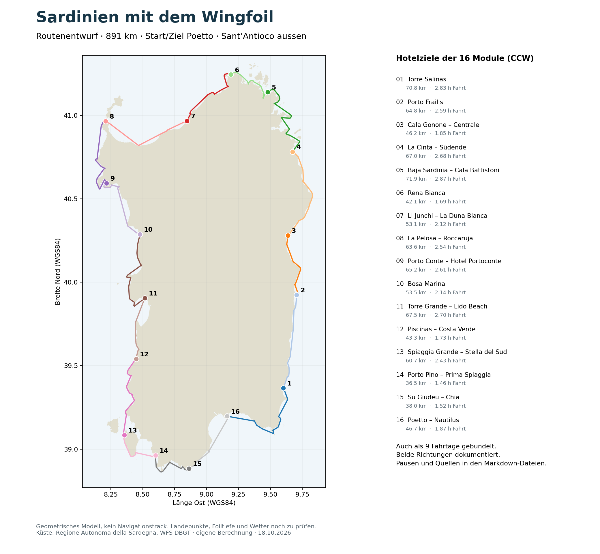

# Sardinien mit dem Wingfoil umrunden

Stand: 18.10.2026. Sprache: Deutsch. Reisezeit: September; Reisejahr noch offen.

Der erste recherchierte Routenentwurf liegt vor: **rund 891 km, 58 Landeplatzkandidaten und eine Hotelkette rund um Sardinien**, mit Start/Ziel Cagliari/Poetto und Aussenumrundung von Sant’Antioco. Beides ist als Arbeitsumfang bestätigt.

Die Route ist in **16 flexible Module** aufgeteilt und alternativ zu **neun Fahrtagen** gebündelt, jeweils mit 2–3 Pausen und in beiden Fahrtrichtungen. Alle Tage bleiben bei konstant 25 km/h unter fünf rechnerischen Fahrstunden. Wetterwartezeiten und langsamere Fahrt sind noch nicht simuliert. Exakte Landepunkte, Foiltiefen und einzelne Hotel-Fusswege bleiben offen; die Ergebnisse sind entsprechend als Kandidaten gekennzeichnet.

Zum Einstieg: [Routen und Etappen](docs/06-routenvarianten.md) · [Landeplätze](docs/05-landeplaetze-index.md) · [Offene Prüfungen](docs/07-offene-pruefungen.md).

## Ziel und Phasen

1. **Phase 1:** Landeplätze recherchieren, nachvollziehbar bewerten und daraus eine zusammenhängende Umrundung mit Übernachtungszielen, 2–3 Pausen pro Tag und Alternativen entwerfen. Ausgangswert: ca. 25 km/h und bis ca. 5 Stunden täglich auf dem Wingfoil.
2. **Phase 2:** Die Varianten mit historischen September-Winddaten und ergänzenden Seegangs-/Strömungsdaten simulieren. Fahrbarkeit und Reisedauer ergeben sich erst unter den gewählten Bedingungen.

Hotelöffnungszeiten werden auf ausdrücklichen Wunsch nicht geprüft. Für Hotels werden Lage und Fussweg vom Landepunkt erfasst. Zugang und Regeln, Materiallogistik im Hotel sowie eine gesonderte Bewertung der Belegqualität sind nicht Teil der Planung. Quellenlinks bleiben Bestandteil der Dokumentation.

## Dokumente

| Datei | Inhalt |
|---|---|
| [Planungsrahmen](docs/01-planungsrahmen.md) | Vorgaben, vorgeschlagene Annahmen, Reichweite und offene Entscheidungen |
| [Bewertung der Landeplätze](docs/02-bewertung-landeplaetze.md) | Versorgungskategorien, Pflichtfelder und technische Eignung |
| [Datenquellen und APIs](docs/03-datenquellen.md) | Quellen, Zugangswege, Grenzen und tatsächlich geprüfte Abrufe |
| [Prompt für Phase 1](docs/04-prompt-phase-1.md) | Kopierbarer Arbeitsauftrag für die anschliessende Routenplanung |
| [Landeplätze-Index](docs/05-landeplaetze-index.md) | 58 Steckbriefe mit Quellen, Bewertung und Versorgung |
| [Routenvarianten](docs/06-routenvarianten.md) | 16 Module / 9 Fahrtage, CCW und CW, 50 Etappenblätter |
| [Offene Prüfungen](docs/07-offene-pruefungen.md) | Ungeklärte Landepunkte, Fusswege und persönliche Grenzen |
| [Phase-2-Übergabe](docs/08-phase-2-uebergabe.md) | Datenstruktur und Auftrag für die historische Simulation |
| [Methodik und Daten](docs/09-methodik-und-daten.md) | Wasserwegmodell, API-Abrufe, Reproduktion und Grenzen |
| [Quellenregister](docs/10-quellenregister.md) | Quellen je Landeplatz |
| [Vorlage Landeplatz](templates/landeplatz.md) | Steckbrief mit Quellen je Aussage |
| [Vorlage Etappe](templates/etappe.md) | Teilstrecken, Pausen, Hotels, Alternativen und Nachweise |

## Daten und Nachvollziehbarkeit

Unter [data/phase1](data/phase1/) liegen archivierte API-Daten, Rechercheinput und GeoJSON für Küste, Route und Landeplätze. [Methodik und Befehle](docs/09-methodik-und-daten.md) erklären den Wiederaufbau. Konsistenzprüfung offline: `python3 scripts/validate_plan.py`.

Die fachlichen Ergebnisse werden in Markdown dokumentiert. Maschinenlesbare Rohdaten dürfen ergänzend als JSON/XML und später GeoJSON/GPX abgelegt werden; sie ersetzen die Markdown-Dokumentation nicht.

[scripts/check_sources.py](scripts/check_sources.py) prüft drei öffentliche Geo-Dienste mit kleinen Leseabfragen. Ausführen mit `python3 scripts/check_sources.py`. Jeder Lauf erhält ein eigenes Verzeichnis unter `data/source-checks/` mit Abfrageparametern, UTC-Abrufzeit, HTTP-Ergebnis, Prüfsumme und gegebenenfalls Rohantwort. Es werden keine Konten oder API-Schlüssel benötigt.

OSM-Daten: © OpenStreetMap contributors, [ODbL und Quellenangabe](https://www.openstreetmap.org/copyright). Andere Quellen werden getrennt mit ihren jeweiligen Nutzungsbedingungen geführt.
