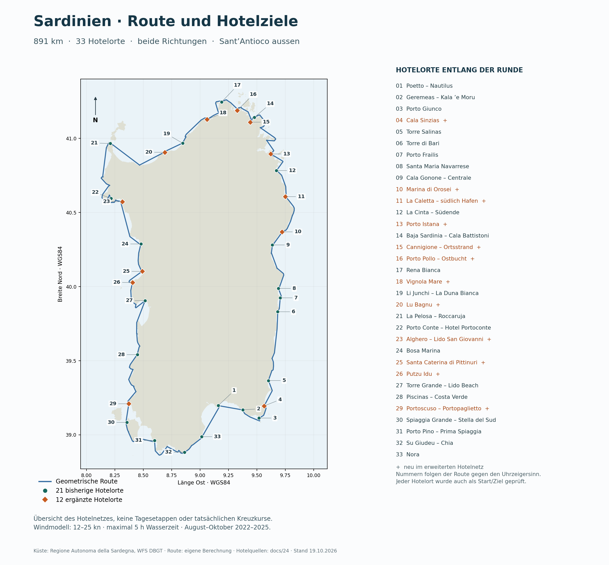

# Erweiterte Hotelziele und erneuter Richtungs-/Startortvergleich

Stand: 19.10.2026. **33 Hotelziele statt 21**, davon zwölf neu belegte Übernachtungsorte an bestehenden Landeplätzen. Unverändert: 12–25 kn, alle Windrichtungen mit Aufkreuzen, Basis- und vorsichtiges Leistungsmodell, maximal fünf Stunden Wasserzeit pro Tag, Fahrzeitfenster 09–17 Uhr und 25 Minuten Landpause zwischen Fahrstücken. Winddaten August–Oktober 2022–2025. Starttermine täglich im August; Septemberstarts sind ergänzend archiviert. Ende spätestens 31. Oktober.

## Ergebnis für Auguststarts

**776 vollständige Runden unter 16368 August-Kombinationen.** Diese Zählung ist keine Erfolgswahrscheinlichkeit: Starttage überlappen und der Planer kennt den historischen Wetterverlauf. Jede vollständige Runde führt rund 890.8 km zum gewählten Starthotel zurück.

| Modell | Richtung | Vollständig / Versuche | Jahre mit voller Runde | Schnellste volle Runde¹ | Max. Fortschritt vorher → jetzt |
|---|---|---:|---|---:|---:|
| Basis | Gegen Uhrzeigersinn | 605 / 4092 | 2023, 2024, 2025 | 61 Tage | 776.8 → 890.8 km |
| Basis | Im Uhrzeigersinn | 171 / 4092 | 2023 | 60 Tage | 823.3 → 890.8 km |
| Vorsichtig | Gegen Uhrzeigersinn | 0 / 4092 | – | – | 666.7 → 801.1 km |
| Vorsichtig | Im Uhrzeigersinn | 0 / 4092 | – | – | 704.6 → 808.7 km |

Ab dem ursprünglichen Start Poetto sind 0 von 496 Augustläufen vollständig. Die Startortwahl bleibt deshalb auch mit dichterem Hotelnetz relevant.

¹ Kalendertage inklusive Start- und Ankunftstag sowie Wartezeiten ab gewähltem Startdatum. Die Maxima vorher/jetzt dürfen aus unterschiedlichen Jahren stammen. Die zusätzlichen Startorte und die zusätzlichen Zwischenhotels werden gemeinsam verglichen.

## Karte des erweiterten Hotelnetzes



[SVG-Karte](../data/phase2/hotel-network-overview.svg) · [Zusammenfassung auf der Startseite](../README.md). Orange Rauten markieren die zwölf neuen Hotelorte. Nummern folgen der Route gegen den Uhrzeigersinn, keine festen Tagesetappen. Karte reproduzieren: `python3 scripts/plot_hotel_network.py`.

## Neu belegte Hotelziele und Quellen

Entfernungen beziehen sich auf den genannten Strand, nicht auf einen vermessenen Fussweg ab dem mathematischen Routenpunkt. Die Simulation arbeitet wie bisher auf Strandort-Ebene. Hotelöffnungen und Verfügbarkeit bleiben auf Wunsch unberücksichtigt; das heutige Unterkunftsnetz wird für alle vier Wetterjahre verwendet.

| Landeplatz | Unterkunft | Strandnähe / Quelle |
|---|---|---|
| Cala Sinzias | [Cala Sinzias Resort](https://www.calasinziasresort.it/en/services/beach/cala-sinzias.html) | 200 m vom Strand über internen Fussweg laut Betreiber |
| Marina di Orosei | [Club Hotel Marina Beach](https://www.marinabeach.it/hotel/) | 150 m vom Strand Marina di Orosei laut Betreiber |
| La Caletta – südlich Hafen | [Cala della Torre Resort](https://caladellatorrevillage.com/) | 500 m vom öffentlichen Strand; Lage beim Hafen laut Betreiber, Distanz laut Veranstalter; [Distanzquelle](https://www.lavacanzaitaliana.it/wp-content/uploads/2024/04/CALA-DELLA-TORRE-ESTATE-2024-1-1.pdf) |
| Porto Istana | [Park Hotel Porto Istana](https://www.parkhotelportoistana.it/en/) | 250 m vom Strand Porto Istana laut Betreiber |
| Cannigione – Ortsstrand | [Hotel Cala di Falco](https://www.hotelcaladifalco.com/) | Wenige Dutzend Meter vom Hotelpool zum Ortsstrand, über die Strasse laut Betreiber |
| Porto Pollo – Ostbucht | [Il Nido dei Gabbiani – Hotel & Residence](https://ilnidodeigabbiani.it/en/welcome-to-il-nido-dei-gabbiani/) | 600 m zum nächsten Strand laut Betreiber; Hotel-/Residence-Unterkunft |
| Vignola Mare | [Hotel Petri Marini](https://www.petrimarinihotel.com/en/) | Ca. 250 m vom Strand Vignola Mare laut Booking; Standort beim Betreiber bestätigt; [Distanzquelle](https://www.booking.com/hotel/it/petri-marini.html) |
| Lu Bagnu | [Hotel Residence Ampurias](https://www.ampurias.net/) | 10 m von der Bucht Sacro Cuore / Lu Bagnu laut Betreiber; Hotelzimmer verfügbar |
| Alghero – Lido San Giovanni | [Hotel Riviera Alghero](https://hotelriviera-alghero.com/) | Wenige Schritte vom Lido di Alghero laut Betreiber |
| Santa Caterina di Pittinuri | [Hotel La Baja](https://www.felixhotels.it/en/hotel-la-baja-santa-caterina-di-pittinuri/) | Über der gleichnamigen Strandbucht, strandnah laut Betreiber |
| Putzu Idu | [Hotel Maluentu](https://www.maluentu.net/) | Direkt am Strand Putzu Idu laut Betreiber |
| Portoscuso – Portopaglietto | [Hotel Lido degli Spagnoli](https://www.lidodeglispagnoli.com/en/) | Am Meer bei Portopaglietto; ca. 4 Minuten zum Strand laut Google-Hotelprofil; [Distanzquelle](https://www.google.it/travel/hotels/entity/CgsIlY_zz7CavYOXARAB) |

Alle oben aufgeführten Quellen wurden am 19.10.2026 ausgewertet. Hotel-/Residence-Anlagen zählen nur mit Hotelangebot; reine Campingplätze wurden nicht als Hotelersatz aufgenommen.

## Verkürzte Hotelabstände

Die folgenden Strecken zeigen die Aufteilung in Gegen-Uhrzeigersinn-Reihenfolge. Alle Distanzen stammen unverändert aus dem vorhandenen Wasserwegmodell; in Gegenrichtung gelten dieselben Längen.

| Bisherige Hotelstrecke | Vorher | Neue Zwischenziele | Neue Teilstrecken |
|---|---:|---|---|
| Porto Giunco → Torre Salinas | 33.5 km | Cala Sinzias | 12.1 + 21.3 km |
| Cala Gonone – Centrale → La Cinta – Südende | 67.0 km | Marina di Orosei → La Caletta – südlich Hafen | 12.6 + 32.2 + 22.2 km |
| La Cinta – Südende → Baja Sardinia – Cala Battistoni | 71.9 km | Porto Istana | 19.4 + 52.5 km |
| Baja Sardinia – Cala Battistoni → Rena Bianca | 42.1 km | Cannigione – Ortsstrand → Porto Pollo – Ostbucht | 7.1 + 19.3 + 15.8 km |
| Rena Bianca → Li Junchi – La Duna Bianca | 53.1 km | Vignola Mare | 24.1 + 29.0 km |
| Li Junchi – La Duna Bianca → La Pelosa – Roccaruja | 63.6 km | Lu Bagnu | 15.2 + 48.4 km |
| Porto Conte – Hotel Portoconte → Bosa Marina | 53.5 km | Alghero – Lido San Giovanni | 15.5 + 38.0 km |
| Bosa Marina → Torre Grande – Lido Beach | 67.5 km | Santa Caterina di Pittinuri → Putzu Idu | 21.6 + 15.8 + 30.1 km |
| Piscinas – Costa Verde → Spiaggia Grande – Stella del Sud | 60.7 km | Portoscuso – Portopaglietto | 46.4 + 14.3 km |

## Vergleich je Wetterjahr – Auguststarts

| Jahr | Modell | Richtung | Vollständig / Versuche | Max. Strecke ab beliebigem Hotel | Max. Strecke ab Poetto |
|---|---|---|---:|---:|---:|
| 2022 | Basis | Gegen Uhrzeigersinn | 0 / 1023 | 817.4 km | 635.6 km |
| 2022 | Basis | Im Uhrzeigersinn | 0 / 1023 | 695.6 km | 570.1 km |
| 2022 | Vorsichtig | Gegen Uhrzeigersinn | 0 / 1023 | 540.5 km | 194.3 km |
| 2022 | Vorsichtig | Im Uhrzeigersinn | 0 / 1023 | 617.5 km | 346.1 km |
| 2023 | Basis | Gegen Uhrzeigersinn | 394 / 1023 | 890.8 km | 844.1 km |
| 2023 | Basis | Im Uhrzeigersinn | 171 / 1023 | 890.8 km | 755.2 km |
| 2023 | Vorsichtig | Gegen Uhrzeigersinn | 0 / 1023 | 801.1 km | 665.6 km |
| 2023 | Vorsichtig | Im Uhrzeigersinn | 0 / 1023 | 808.7 km | 709.0 km |
| 2024 | Basis | Gegen Uhrzeigersinn | 41 / 1023 | 890.8 km | 431.0 km |
| 2024 | Basis | Im Uhrzeigersinn | 0 / 1023 | 836.8 km | 766.0 km |
| 2024 | Vorsichtig | Gegen Uhrzeigersinn | 0 / 1023 | 758.4 km | 194.3 km |
| 2024 | Vorsichtig | Im Uhrzeigersinn | 0 / 1023 | 779.8 km | 709.0 km |
| 2025 | Basis | Gegen Uhrzeigersinn | 170 / 1023 | 890.8 km | 844.1 km |
| 2025 | Basis | Im Uhrzeigersinn | 0 / 1023 | 801.1 km | 570.1 km |
| 2025 | Vorsichtig | Gegen Uhrzeigersinn | 0 / 1023 | 662.3 km | 70.8 km |
| 2025 | Vorsichtig | Im Uhrzeigersinn | 0 / 1023 | 801.1 km | 346.1 km |

## Startorte im Vergleich

Rangfolge: zuerst Anzahl vollständiger Augustläufe, danach Median des erreichten Fortschritts, danach kürzeste vollständige Reisedauer. Jeder Ort hat 124 Augustläufe (31 Tage × vier Jahre). Das ist eine rückblickende Auswahl, keine Windprognose für eine zukünftige Reise.

| Modell | Richtung | Startort | Vollständig / 124 | Median Strecke | Kürzeste volle Runde |
|---|---|---|---:|---:|---:|
| Basis | Gegen Uhrzeigersinn | Su Giudeu – Chia | 55 | 682.3 km | 65 Tage |
| Basis | Gegen Uhrzeigersinn | Porto Pino – Prima Spiaggia | 51 | 720.3 km | 64 Tage |
| Basis | Gegen Uhrzeigersinn | Porto Istana | 45 | 672.1 km | 61 Tage |
| Basis | Gegen Uhrzeigersinn | La Cinta – Südende | 44 | 691.5 km | 62 Tage |
| Basis | Gegen Uhrzeigersinn | La Caletta – südlich Hafen | 43 | 713.7 km | 62 Tage |
| Basis | Im Uhrzeigersinn | Alghero – Lido San Giovanni | 30 | 695.6 km | 63 Tage |
| Basis | Im Uhrzeigersinn | Bosa Marina | 30 | 473.3 km | 62 Tage |
| Basis | Im Uhrzeigersinn | Putzu Idu | 29 | 510.8 km | 63 Tage |
| Basis | Im Uhrzeigersinn | Santa Caterina di Pittinuri | 29 | 495.0 km | 63 Tage |
| Basis | Im Uhrzeigersinn | Torre Grande – Lido Beach | 28 | 540.8 km | 60 Tage |
| Vorsichtig | Gegen Uhrzeigersinn | Cala Gonone – Centrale | 0 | 662.3 km | – |
| Vorsichtig | Gegen Uhrzeigersinn | Marina di Orosei | 0 | 649.7 km | – |
| Vorsichtig | Gegen Uhrzeigersinn | La Caletta – südlich Hafen | 0 | 617.5 km | – |
| Vorsichtig | Gegen Uhrzeigersinn | La Cinta – Südende | 0 | 595.3 km | – |
| Vorsichtig | Gegen Uhrzeigersinn | Porto Istana | 0 | 575.9 km | – |
| Vorsichtig | Im Uhrzeigersinn | Su Giudeu – Chia | 0 | 617.5 km | – |
| Vorsichtig | Im Uhrzeigersinn | Porto Pino – Prima Spiaggia | 0 | 579.5 km | – |
| Vorsichtig | Im Uhrzeigersinn | Spiaggia Grande – Stella del Sud | 0 | 543.1 km | – |
| Vorsichtig | Im Uhrzeigersinn | Portoscuso – Portopaglietto | 0 | 528.8 km | – |
| Vorsichtig | Im Uhrzeigersinn | Cala Sinzias | 0 | 507.6 km | – |

## Beispielverläufe

Je Modell/Richtung: schnellste vollständige Augustreise; falls keine vollständig ist, der weiteste Augustlauf. Datum und Dauer schliessen Wartezeiten ein. Die vollständigen Tageslisten stehen im [Reiseverlauf-Dokument](25-reiseverlaeufe-erweitertes-hotelnetz.md).

| Modell | Richtung | Startort | Bereit ab | Erste Fahrt | Ende / Auswertung bis | Strecke | Fahrtage | Wartetage |
|---|---|---|---|---|---|---:|---:|---:|
| Basis | Gegen Uhrzeigersinn | Porto Istana | 2023-08-31 | 2023-08-31 | 2023-10-30 | 890.8 km | 16 | 45 |
| Basis | Im Uhrzeigersinn | Torre Grande – Lido Beach | 2023-08-28 | 2023-08-28 | 2023-10-26 | 890.8 km | 15 | 45 |
| Vorsichtig | Gegen Uhrzeigersinn | Portoscuso – Portopaglietto | 2023-08-01 | 2023-08-01 | 2023-10-31 | 801.1 km | 18 | 74 |
| Vorsichtig | Im Uhrzeigersinn | Santa Maria Navarrese | 2023-08-01 | 2023-08-18 | 2023-10-31 | 808.7 km | 16 | 76 |

## Verbleibende Engpässe

Die folgende Tabelle zeigt die seltensten Hotelpassagen nach Anzahl fahrbarer Tage über alle vier Jahre (je Jahr 92 Tage). Eine neue Übernachtung verkürzt die Tagesstrecke, erzeugt aber keinen Wind. Vor allem unbesiedelte Küstenabschnitte können weiterhin längere Hotelabstände behalten.

| Modell | Richtung | Hotelstrecke | km | 2022 | 2023 | 2024 | 2025 |
|---|---|---|---:|---:|---:|---:|---:|
| Basis | Gegen Uhrzeigersinn | Santa Maria Navarrese → Cala Gonone – Centrale | 37.4 | 4 | 8 | 2 | 8 |
| Basis | Gegen Uhrzeigersinn | Torre Salinas → Torre di Bari | 54.0 | 5 | 7 | 9 | 2 |
| Basis | Gegen Uhrzeigersinn | Nora → Poetto – Nautilus | 27.5 | 7 | 13 | 9 | 5 |
| Basis | Im Uhrzeigersinn | Torre di Bari → Torre Salinas | 54.0 | 3 | 10 | 2 | 4 |
| Basis | Im Uhrzeigersinn | Cala Gonone – Centrale → Santa Maria Navarrese | 37.4 | 2 | 7 | 4 | 7 |
| Basis | Im Uhrzeigersinn | Poetto – Nautilus → Nora | 27.5 | 5 | 10 | 8 | 6 |
| Vorsichtig | Gegen Uhrzeigersinn | Santa Maria Navarrese → Cala Gonone – Centrale | 37.4 | 3 | 6 | 1 | 5 |
| Vorsichtig | Gegen Uhrzeigersinn | Torre Salinas → Torre di Bari | 54.0 | 2 | 6 | 8 | 0 |
| Vorsichtig | Gegen Uhrzeigersinn | Porto Istana → Baja Sardinia – Cala Battistoni | 52.5 | 0 | 8 | 5 | 6 |
| Vorsichtig | Im Uhrzeigersinn | Cala Gonone – Centrale → Santa Maria Navarrese | 37.4 | 0 | 4 | 3 | 3 |
| Vorsichtig | Im Uhrzeigersinn | Torre di Bari → Torre Salinas | 54.0 | 2 | 8 | 1 | 3 |
| Vorsichtig | Im Uhrzeigersinn | Porto Conte – Hotel Portoconte → La Pelosa – Roccaruja | 65.2 | 5 | 7 | 4 | 4 |

## Reproduktion und Grenzen

Archiviert sind 32208 Läufe: 33 Orte × 61 Starttermine im August/September × vier Jahre × zwei Richtungen × zwei Modelle. Insgesamt vollständig: 778. Die Haupttabellen oben beziehen sich ausschliesslich auf August.

- [Erweitertes Hotelnetz](../data/phase2/hotel-network-expanded.json) mit Quellen; das bisherige 21-Orte-Netz bleibt als Referenz erhalten.
- [Resultate und Tageskalender](../data/phase2/start-analysis-expanded/) enthalten Hotelnetz-Prüfsummen zur Vermeidung veralteter Cache-Nutzung.
- [Validierung](../data/phase2/start-analysis-expanded/validation.json): alle bisherigen 20.496 Startversuche müssen mindestens denselben Fortschritt erlauben; repräsentative Reisen werden mit Wind, Küste, Hotelzielen und Fünf-Stunden-Grenze erneut geprüft.
- Die [archivierten Wind-API-Daten](11-wind-api-und-daten.md) samt [August-Erweiterung](17-ab-august-180-grad.md) werden wiederverwendet. Für Hotelnähe wurden Betreiberseiten und gekennzeichnete Distanzquellen genutzt; neue Wetter-API-Abrufe waren nicht nötig.
- Unverändert: hypothetische Leistungspolaren, grobes Windraster, lokale Kreuzschläge statt grossräumiger Offshore-Routen und historischer Vorausblick. Wellen und Strömungen werden in dieser Rechnung nicht neu modelliert.
- Ein weiter erreichter Hotelort wird bei unvollständigen Läufen bis 31. Oktober gehalten; das Feld Ende ist dann der Auswertungsstichtag, nicht zwingend der letzte Fahrtag.

```sh
python3 scripts/analyze_start_locations.py --expanded
python3 scripts/report_expanded_hotels.py
python3 scripts/validate_start_locations.py --expanded
python3 -m unittest discover -s scripts -p 'test_*.py'
```
